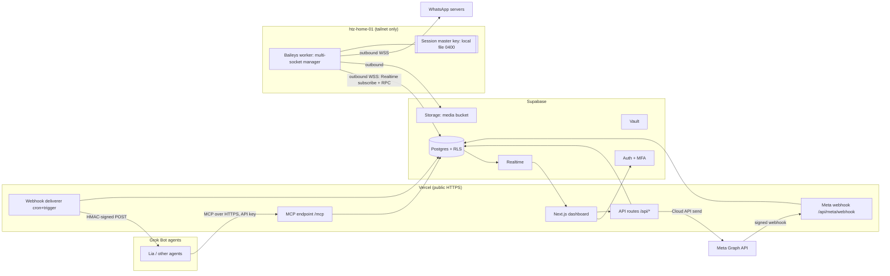
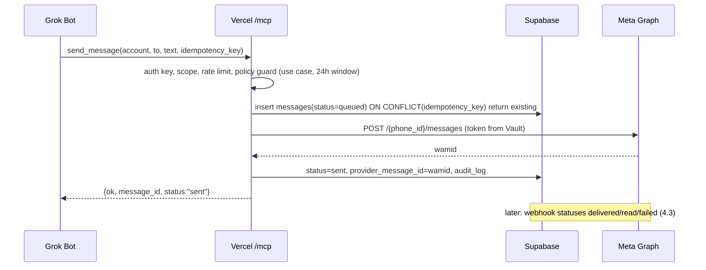
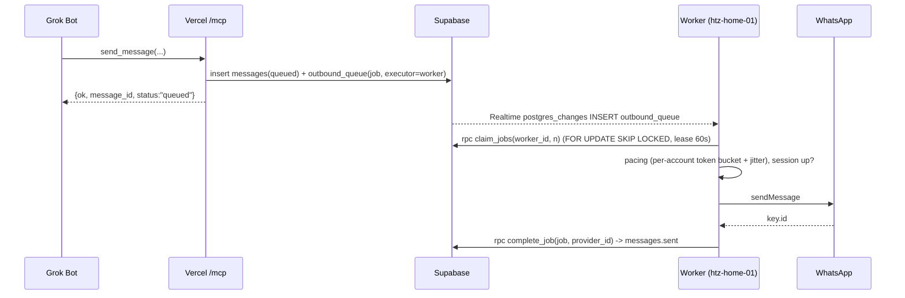
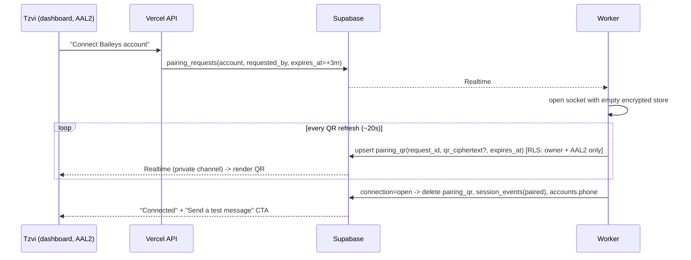

# WhatsApp Gateway: Architecture (v1.0)

Owner: Software Architect, H.T.Z Studios · Status: **v1.0, approved by Tzvi 2026-10-21** (merge to main, production deploy and cutover each still need separate approval) · Date: 2026-10-21
Inputs: PM brief, Researcher findings, QA behaviour map of WhatsApp-Automation, WhatsApp Automator hand-off, code review of `WhatsApp-Automation@4406451` (Cursor Origin), `nexus` (GitHub) and `whatsapp-status-automator` (Origin).
Companion contract: [`contracts/lia-connection-test.md`](contracts/lia-connection-test.md) (status enum is canonical here and mirrored there).

---

## 1. Context, goals, non-goals

**Context.** Grok Bot agents (Lia and others) need one controlled way to talk to WhatsApp. Today `WhatsApp-Automation` runs on htz-home-01 with a single Baileys socket, SQLite, an MCP bridge and an unconfigured Meta Cloud API reminder path. The Gateway **replaces and absorbs** it (two Baileys sessions on one number conflict).

**Goals**
1. One provider-agnostic API/MCP for **Baileys** (WhatsApp Web, unofficial) and **Meta WhatsApp Business Cloud API** (official): text, media, templates, groups (Baileys), receipts/status.
2. Multi-account from day one (N Baileys sockets + N Cloud API phone numbers).
3. Dashboard (Vercel, Next.js, impeccable.style, Hebrew/RTL, mobile): connect accounts (QR / Cloud credentials), health, logs, failed messages, alerts, one-click reconnect/resend.
4. Grok Bot integration through **MCP** (v1-compatible superset of today's 12 tools) and **signed outbound webhooks** (agent relay, e.g. Lia).
5. Zero-regression migration: every automation/reminder working today keeps working after cutover without reconfiguration; re-linking = at most one QR scan.
6. Security first: no inbound port on the home server, secrets never reach agents or browsers, full audit trail.

**Success metrics baked into schema/dashboard** (§8.4): first connect + first message in minutes without docs; plain-language error states with Reconnect/Resend; same UX per provider with a provider badge; MCP works from first setup; failed-message rate per provider; Baileys session lifetime; reconnect time; webhook-to-send latency; Lia first-response time and no-reply rate; migration without breakage; no inherited silent bugs (capability flags).

**Non-goals (v1)**: public SaaS/billing; general-purpose AI chatbot over Cloud API (forbidden, §7.7); WhatsApp Channels/Newsletters and Communities admin; Cloud API template *authoring* (we use templates approved in Meta Business Manager); full pre-activation history import; calls.

---

## 2. System overview



| Component | Responsibilities |
|---|---|
| **Vercel: Next.js app** | Dashboard UI (App Router, RSC, Hebrew default, RTL), Server Actions/API routes for account mgmt, send/resend, template list. **Cloud API sends execute here** (direct Graph call). |
| **Vercel: `/mcp`** | Streamable HTTP, stateless MCP server (ported from WA-Automation). API-key auth, scopes, rate limits, audit. |
| **Vercel: `/api/meta/webhook`** | GET hub challenge (`hub.verify_token`), POST verified via `X-Hub-Signature-256` over raw body. Writes `inbound_events`, returns 200 fast. |
| **Vercel: deliverer** | Sends outbound webhooks (agent relay batches, message events) with HMAC + retries. Triggered by `pg_net`/DB webhook on insert, plus a 1-min **Supabase pg_cron → Edge Function** sweep for retries (no Vercel Cron: Hobby is daily-only). |
| **Supabase Postgres** | Source of truth: accounts, messages, queue, sessions, audit, metrics. RLS on every table. |
| **Supabase Auth** | Dashboard users (email + password + **TOTP MFA required**, AAL2 enforced in RLS). |
| **Supabase Realtime** | Push queue jobs to worker; push session/QR/health to dashboard. |
| **Supabase Vault** | Meta access tokens, app secrets, webhook signing secrets, agent webhook keys. |
| **Supabase Storage** | Private `media` bucket (inbound/outbound media, voice notes); access only via short-lived signed URLs. |
| **htz-home-01 worker** | Node 22/TS, ESM. One Baileys socket per Baileys account, encrypted auth store, pacing, automation engine (status replies), agent-relay debounce, STT for voice, heartbeats. Outbound connections only. systemd `--user` unit (no Docker/sudo available to `deploy`). |

---

## 3. Provider abstraction

```ts
type ProviderKind = 'baileys' | 'meta_cloud';

interface Capabilities {            // persisted per account in accounts.capabilities (jsonb)
  text: true; media: boolean; voiceNotes: boolean; reactions: boolean;
  templates: boolean; freeFormOutside24h: boolean;
  groups: 'full' | 'none'; statusStories: boolean;
  nativeButtons: 'supported' | 'unsupported' | 'unverified';
  lists: 'supported' | 'unsupported' | 'unverified';
  readReceipts: boolean; typingPresence: boolean; initiateConversation: boolean;
}

interface OutboundMessage {
  accountId: string; to: string;                     // E.164 or JID; normalised by provider
  kind: 'text' | 'media' | 'template' | 'reaction' | 'interactive';
  text?: string; media?: { storagePath: string; mime: string; caption?: string; voice?: boolean };
  template?: { name: string; language: string; params: string[] };
  quotedProviderId?: string; idempotencyKey: string; useCase: UseCase;
}

interface SendResult { ok: boolean; providerMessageId?: string;
  error?: { code: GatewayErrorCode; transient: boolean; detail?: string } }

interface WhatsAppProvider {
  readonly kind: ProviderKind;
  capabilities(accountId: string): Capabilities;
  send(msg: OutboundMessage): Promise<SendResult>;
  markRead(accountId: string, chat: string, ids: string[]): Promise<void>;
  setPresence(accountId: string, chat: string, p: 'composing' | 'paused'): Promise<void>;
  status(accountId: string): Promise<SessionHealth>;   // never returns secrets/QR
  // Inbound is push: provider emits normalised InboundEvent -> ingest()
}
```
Two implementations: `BaileysProvider` (runs **only in the worker**; Vercel enqueues to `outbound_queue`) and `CloudApiProvider` (runs **on Vercel**, ported from `src/server/meta/cloud.ts`). A `ProviderRouter` picks by `accounts.provider`; MCP/dashboard never branch on provider except to show the badge and capability flags. A whatsmeow (Go) worker could later implement the same queue contract.

**Capability matrix (v1)**

| Feature | Baileys (7.x) | Cloud API |
|---|---|---|
| Text, quoted reply | Yes | Yes |
| Media (image/video/doc/audio), voice notes | Yes | Yes (upload → media id) |
| Free-form outside 24h window | Yes (ban-risk pacing) | **No**: approved template required |
| Templates | N/A (plain text) | Yes (approved in Business Manager) |
| Native buttons / lists | **`unsupported` on personal accounts** (legacy `buttonsMessage`/`listMessage` usually dropped by WhatsApp); fallback = numbered text. Re-test in spike → may flip to `unverified` | Yes (interactive reply buttons ≤3, lists ≤10) inside 24h |
| Groups | Read/send/metadata (LID-based) | No |
| Status (stories) read + reply automations | Yes | No |
| Read receipts / typing | Yes (opt-in; we send read only where policy allows) | Read: yes; typing indicator: yes (Graph) |
| Delivery statuses | `messages.update` (server/delivery/read) | Webhook `statuses` (sent/delivered/read/failed) |
| Initiate conversation | Policy-gated (§7.6) | Template only |

**Rule: no silent failures.** Any request using an `unsupported` capability is rejected at the API/MCP layer with `code: capability_unsupported` and the dashboard shows the flag; a send that degrades (buttons→numbered text) records `delivery_mode='fallback'` visibly in the log.

---

## 4. Message flows

### 4.1 Outbound via MCP, Cloud API

Transient Graph errors (network/429/5xx) → row moves to `outbound_queue` with backoff, processed by **Supabase pg_cron every minute → Edge Function** (`pg_net`), not Vercel Cron (Hobby = daily only); Cloud jobs have `executor='edge'`. Backoff 5s/30s/2m is honored within the minute tick via `next_attempt_at`.

### 4.2 Outbound via MCP, Baileys

Fallback: every 30-60s the worker calls `claim_jobs` anyway (reconciliation when Realtime drops); expired leases are reclaimed. MCP may wait up to ~5s for `sent` (`wait: true` param) to give agents sync semantics.

### 4.3 Inbound, Cloud API webhook
```mermaid
sequenceDiagram
  participant G as Meta
  participant H as Vercel /api/meta/webhook
  participant DB as Supabase
  participant D as Deliverer
  G->>H: POST (X-Hub-Signature-256)
  H->>H: read RAW body, HMAC-SHA256(app_secret), timingSafeEqual; 401 if bad
  H->>DB: insert inbound_events(dedupe on entry/message id) -> 200 OK (<1s)
  DB->>DB: trigger: normalise -> messages(direction=in) / status updates (forward-only rank)
  DB->>D: relay rule matches? -> webhook_deliveries row
  D->>Agent: signed POST
```
Status updates use the forward-only ranking already in `meta/webhook.ts` (`sent<delivered<read`, `failed` always wins).

### 4.4 Inbound, Baileys
Worker `messages.upsert` → normalise (LID + `remoteJidAlt` PN) → media downloaded, encrypted transport to Storage → `rpc ingest_inbound(...)` (idempotent on `(account_id, provider_message_id)`) → automation engine (status replies) and/or agent-relay module (§4.7) → `inbound_events`/`messages`. Unknown senders on relay-enabled accounts: **no reply**, logged as `sender_unknown`, visible in dashboard.

### 4.5 QR pairing

QR rows are short-lived (TTL ≤60s each, request ≤3 min), never exposed to MCP/API keys (no policy for `api_client` role), purged on success/expiry, audited. Pairing-code (8-char) flow offered as alternative for mobile users.

### 4.6 Reconnect
Worker reconnect policy (ported from `whatsapp.ts`): exponential backoff 1s→30s cap, reset on `restartRequired`; `loggedOut/badSession` → mark `needs_relink`, wipe store, alert, dashboard shows "החיבור נותק מהטלפון: סרוק QR מחדש"; `connectionReplaced/forbidden` → `conflict` (another client on the number, or ban signal) → stop, alert P1, no auto-retry. Every transition → `session_events` (used for lifetime/reconnect metrics). Dashboard "Reconnect" and MCP `session_reconnect` insert a `session_commands` row the worker consumes.

### 4.7 Agent relay (Lia channel) and outbound webhooks
```mermaid
sequenceDiagram
  participant T as Tzvi (WhatsApp)
  participant W as Worker
  participant DB as Supabase
  participant D as Deliverer (Vercel)
  participant L as Lia (Grok Bot routine webhook)
  T->>W: message(s) / voice / image
  W->>W: allowlist check (sender-allowlist); unknown -> log only
  W->>T: mark read + presence "composing" (immediately)
  W->>W: per-thread debounce timer (default 4s, 3-5s cfg), keep composing alive
  W->>DB: insert relay_batches(batch_id, message_ids[], media signed paths)
  DB->>D: trigger (pg_net) -> deliver
  D->>L: POST JSON, X-Gateway-Signature: t=..,v1=HMAC, Idempotency-Key=batch_id
  L-->>D: 2xx (accepted) | 401/403 (rejected_key) | 5xx/timeout (unreachable, retry)
  L->>Gateway: (MCP) send_message(reply_to_id=batch) -> 'replied'
```
- **Debounce lives in the worker** (stateful, already sees every message, owns presence). It writes one `relay_batches` row; the DB trigger + Vercel deliverer POST it. If the worker restarts mid-window, un-batched messages are re-batched from `messages.relay_state='pending'` on boot.
- **Voice/media**: stored in Storage, payload carries 15-min signed URLs. Voice ≤60s → transcribed in the worker, batch waits for transcript. **Voice >60s → Gateway itself replies "קיבלתי הקלטה, מתמלל" and does NOT wake Lia; Lia is woken once, when the transcript is ready** (no `voice_pending` event). Unsupported types (sticker, location, contact card, poll, view-once) → explicit "סוג הודעה זה עדיין לא נתמך" reply, never silence.
- **STT (decided by PM, no GPU on htz-home-01: i5-8400T 6c AVX2, 7.1GB RAM ~3.3GB free)**: separate long-running `transcriber` systemd --user service, **faster-whisper (CTranslate2) int8 on CPU with [ivrit-ai/whisper-large-v3-turbo-ct2](https://huggingface.co/ivrit-ai/whisper-large-v3-turbo-ct2)**, language forced to Hebrew, model loaded once and kept resident, concurrency 1, low CPU priority (Nice), transcriber unit gets `MemoryMax` (sized to measured peak RSS) and `OOMScoreAdjust=800`; worker unit gets only `MemoryLow` (no negative OOMScoreAdjust: unprivileged user units can only raise it, a negative value needs CAP_SYS_RESOURCE and may stop the unit from starting). So under memory pressure the transcriber dies first, never the Baileys worker. M0 spike verifies the cgroup v2 memory controller is delegated to the user manager (`cat /sys/fs/cgroup/user.slice/user-$UID.slice/user@$UID.service/cgroup.controllers` contains `memory`) and measures peak RSS; est. 1-3x realtime. Python 3.14 OK (ctranslate2 4.8.3 wheels, faster-whisper 1.2.1). Local fallback: ivrit-ai zipformer2-66m. **Soniox = `Transcriber` implementation behind a flag, OFF by default (costs money), only Tzvi enables it.** Voice notes queued in send order and delivered as one batch. If the transcriber is killed mid-job: retry once, then wake Lia with `transcript: null` + plain explanation to Tzvi; audio kept. `nexus` has no STT to reuse. Metric: voice-received-to-transcript latency by audio length, separate from Lia response time.
- **Outbound formatting**: `send_message` on relay accounts converts Markdown → WhatsApp (`**b**`→`*b*`, `*i*`/`_i_`→`_i_`, `~~s~~`→`~s~`, code → ```` ``` ````, headings → bold line, links → `text (url)`), strips unsupported.
- **Delivery status enum (canonical, mirrored in contracts/lia-connection-test.md)**: `accepted` (+`waiting: true` for first 2 min), `replied`, `rejected_key` (401/403), `unreachable` (network/timeout/5xx after retries), `no_reply` (no reply by alert threshold, default 10 min), `delivery_failed` (Lia replied but sending to Tzvi failed).
**Lia channel additions (agreed in team review)**
- Payload carries `is_test: true` for the setup screen's test message (Lia answers with a short ack only).
- Resend to Lia re-sends the same `batch_id` and `message_id`s; dedup on `batch_id`, so no double reply.
- Channel state `untested` is derived from `relay_targets.last_verified_at IS NULL`; set only when a test reaches `replied` (not `accepted`); **any change to the webhook URL or sender key resets it to `null`**. `last_test` holds only the latest test's details. `untested` is a channel state, not a value in the test-status enum, which stays locked.
- Allowlist changes require a confirmation step and are written to the append-only `audit_log` (who, when, before, after); audit rows are exempt from message retention.
- Webhook URL + sender key stored in Vault, masked in UI (last 4 chars).
- If Cloud API is chosen for Lia, the dashboard warns: may violate Meta's WhatsApp Business Solution Terms (AI general assistants barred since 15 Jan 2026), risking number/account ban. Recommended: Baileys. Not blocked; Tzvi decides.
- "Play original" for voice uses a short-lived signed, auth-protected URL; returns an error after retention purge.
- **Outbound URL guard (`policy/outbound-url-guard`, SSRF)** for every user-supplied URL (relay targets, generic webhooks), on save and on every send: `https` only; host on an allowlist of Grok Bot webhook domains for relay targets; resolve DNS, then canonicalize each address with a real IP parser (`ipaddr.js`) and reject loopback, private (10/8, 172.16/12, 192.168/16), CGNAT 100.64/10, link-local 169.254/16 incl. cloud metadata, `0.0.0.0/8`, IPv6 `::1`, `fc00::/7`, `fe80::/10`, IPv4-mapped IPv6 (`::ffff:127.0.0.1`), and numeric/octal/hex host forms (`2130706433`, `0177.0.0.1`); connect to the pinned resolved IP with original hostname in SNI/Host (defeats DNS rebinding); no redirects; connect+total timeout; response body cap (64 KB). Test IDs: QA S3.
- **Generic outbound webhooks** (`message.received`, `message.status`, `session.changed`): same signer. Signature `v1=HMAC_SHA256(secret, timestamp + "." + raw_body)`, receivers reject |now−t|>5 min. Retries: 10s, 30s, 2m, 10m, 30m, 2h (max 6) with jitter → `dead` + alert. Secrets rotatable with dual-secret overlap. Target URLs pass the **outbound URL guard** (SSRF: https only, allowlisted domains, block private/loopback/link-local/CGNAT incl. Tailscale 100.64/10, no redirects, pinned resolved IP).
- **Spike with Lia (open)**: routine webhook rate limits, POST-to-wake latency, burst behaviour, exact wrong-key response. Fallback trigger if webhooks are unsuitable: email to Lia's inbox.

---

## 5. Data model (Supabase)

Conventions: `uuid` PKs, `timestamptz`, `org_id` on every row (single org now, multi-tenant-ready), RLS enabled on **all** tables, `security definer` RPCs with `set search_path = ''` for worker/MCP writes, no direct table grants to `anon`.

| Table | Key columns | Notes / indexes |
|---|---|---|
| `orgs`, `org_members` | `user_id`, `role` (owner/admin/viewer) | RLS helper `is_member(org_id)` + `auth.jwt()->>'aal' = 'aal2'` |
| `accounts` | `provider`, `label`, `phone_e164`, `status`, `capabilities jsonb`, `use_case_policy jsonb`, `is_test bool`, `pacing jsonb` | unique `(org_id, phone_e164, provider)` |
| `provider_credentials` | `account_id`, `vault_secret_id` (token), `app_secret_vault_id`, `phone_number_id`, `waba_id` | **no plaintext**; read only by service role via RPC |
| `baileys_auth_state` | `account_id`, `key_type`, `key_id`, `ciphertext bytea`, `nonce`, `key_version` | see ADR-4; PK `(account_id,key_type,key_id)`; no RLS policy for any user role |
| `sessions` | `account_id`, `connection`, `connected_at`, `last_heartbeat_at`, `worker_id`, `last_error_code` | 1 row/account |
| `session_events` | `account_id`, `event` (open/close/qr/relinked/conflict), `code`, `at` | idx `(account_id, at desc)` |
| `pairing_requests`, `pairing_qr` | `expires_at`, `qr` | TTL purge job; owner+AAL2 select only |
| `contacts` | `account_id`, `pn_jid`, `lid`, `display_name`, `is_allowlisted` | unique `(account_id, coalesce(lid,pn_jid))` |
| `conversations` | `account_id`, `chat_jid`, `type` (direct/group), `last_inbound_at` (24h window), `relay_target_id` | idx `(account_id, last_message_at desc)` |
| `messages` | `account_id`, `conversation_id`, `direction`, `kind`, `body`, `media_path`, `status` (queued→sending→sent→delivered→read / failed / cancelled), `delivery_mode` (native/fallback/text), `provider_message_id`, `idempotency_key`, `api_client_id`, `use_case`, `error_code`, `created_at`, `sent_at`, `delivered_at` | unique `(account_id, provider_message_id)`, unique `(api_client_id, idempotency_key)`, idx `(conversation_id, created_at desc)`, idx `(status) where status in ('queued','failed')` |
| `outbound_queue` | `message_id`, `executor` (worker/vercel), `run_at`, `attempts`, `max_attempts`, `lease_owner`, `lease_until`, `state` (ready/leased/done/dead) | partial idx `(executor, run_at) where state='ready'`; RPC `claim_jobs` uses `FOR UPDATE SKIP LOCKED` |
| `session_commands` | `account_id`, `command` (reconnect/logout/pair), `requested_by` | consumed by worker |
| `inbound_events` | `source` (meta/baileys), `dedupe_key`, `raw jsonb` (redacted), `received_at`, `processed_at` | unique `dedupe_key`; raw purged after 7 days |
| `automations`, `automation_cooldowns`, `statuses`, `reply_jobs` | ported 1:1 from SQLite + `account_id` | keeps status-reply behaviour |
| `reminders` | ported, + `account_id`, `template_*`, `state` (scheduled/queued/sending/sent/delivered/read/failed/unconfigured/cancelled) | idx `(state, due_at)` |
| `relay_targets` | `account_id`, `name` (Lia), `url`, `secret_vault_id`, `debounce_ms`, `allowed_senders` | URL passes SSRF guard on save |
| `relay_batches` | `batch_id`, `message_ids uuid[]`, `status` (canonical enum), `attempts`, `first_response_at` | metrics source |
| `webhook_endpoints`, `webhook_deliveries` | `events[]`, `secret_vault_id`; `status`, `attempt`, `next_attempt_at`, `response_code` | partial idx on pending |
| `api_clients` | `name`, `key_prefix`, `key_hash` (SHA-256 of 32-byte random), `scopes text[]`, `account_ids uuid[]`, `conversation_ids uuid[] null` (CHECK: a key with scope `relay` must have a non-empty `conversation_ids`; null means unrestricted and is allowed only for non-relay keys), `rate_limit`, `expires_at`, `revoked_at`, `last_used_at` | plaintext shown once |
| `audit_log` | `actor_type` (user/api_client/worker/system), `actor_id`, `action`, `target`, `ip`, `meta jsonb`, `at` | append-only (no UPDATE/DELETE grants), hash-chained `prev_hash` |
| `alerts` | `severity`, `kind`, `account_id`, `opened_at`, `ack_by`, `resolved_at` | |
| `worker_heartbeats` | `worker_id`, `version`, `baileys_version`, `sockets jsonb`, `at` | |
| `login_attempts` | `email`, `ip`, `success`, `at` | lockout (§7.5) |

RLS approach: dashboard users → `select` on their org's rows, writes only via Server Actions that call RPCs; `api_client` is **not** a Postgres role (MCP runs server-side and enforces scopes in code, then uses scoped RPCs); worker uses a dedicated Postgres role `gateway_worker` (custom JWT signed for that role, *not* the service-role key) allowed only to execute worker RPCs and write `baileys_auth_state`/`sessions`/`messages`. Realtime channels for the dashboard are **private** with RLS on `realtime.messages`.

**Metrics views**: `v_transcript_latency` (voice received → transcript ready, bucketed by audio length; shown on Health), `v_failed_rate_by_provider` (24h/7d), `v_session_lifetime` (open→close durations), `v_reconnect_time` (close→open), `v_send_latency` (MCP/webhook request → `sent_at`, p50/p95), `v_relay_first_response` (Tzvi msg → Lia first reply), `v_relay_no_reply_rate`, `v_first_connect_funnel` (account created → paired → first message).

---

## 6. MCP server

Streamable HTTP, stateless, at `https://<gateway>/mcp` (ported `src/server/mcp/`). Stdio mode dropped (it would spawn a second socket). **v1-compatible superset**: the 12 existing tools keep exact names and params so current Grok Bot configs keep working (`list_automations` (QA listed it as `list_automation`; the real name is plural), `create_automation`, `update_automation`, `delete_automation`, `send_message`, `update_reply`, `get_thread`, `send_reminder`, `list_reminders`, `cancel_reminder`, `session_status`, `session_reconnect`). Without `account`, tools resolve to the account mapped to `default`/`meta-default` (migration aliases).

New tools (optional `account` param everywhere): `list_accounts`, `send_media` (upload via signed URL), `send_template`, `list_templates`, `list_chats`, `get_messages` (paged, cursor), `get_message_status`, `resend_message`, `mark_read`, `list_groups` / `send_group_message` (Baileys, scope `groups:send`), `get_capabilities`.

| Aspect | Design |
|---|---|
| Auth | `Authorization: Bearer gw_<prefix>_<secret>`; lookup by prefix, compare SHA-256 with `timingSafeEqual`. Migrated legacy tokens keep working (their hashes are imported). |
| Scopes | Existing 7 (`automations:read/write`, `messages:send`, `reminders:send`, `threads:read`, `sessions:read/write`) + `media:send`, `templates:send`, `groups:read/send`, `accounts:read`. Keys bound to `account_ids`; optional **conversation-scoped keys** (WAHA-style per-session scoping, narrowed to chats) for agents like Lia that only talk to Tzvi. |
| Rate limits | Postgres token bucket per key (default 60 req/min, 20 sends/min) plus per-account provider pacing; 429 with `retry_after`. |
| Never exposed | QR payloads, auth state, Meta tokens, webhook secrets, other accounts. |
| Errors | `{ok:false, code, message_he, message_en, action}` e.g. `session_disconnected` → "reconnect", `outside_24h_window` → "use send_template", `capability_unsupported`, `use_case_not_allowed`. |
| Audit | Every tool call → `audit_log` (args hashed/redacted for bodies). |

---

## 7. Security

### 7.1 Threat model (STRIDE-lite)

| Threat | Vector | Mitigation |
|---|---|---|
| **S**poofing | Forged Meta webhook; forged agent; stolen dashboard session | HMAC raw-body check + verify token; per-key hashed API keys; Supabase Auth + mandatory TOTP (AAL2) |
| **T**ampering | Queue/messages altered; replayed webhook | RLS + RPC-only writes; dedupe keys; timestamped HMAC on our outbound webhooks; append-only hash-chained audit |
| **R**epudiation | "Who sent this?" | `api_client_id`/`user_id` on every message, audit log |
| **I**nfo disclosure | Session theft = full WhatsApp account takeover; PII in logs | Auth state AES-256-GCM, key only on htz-home-01; Vault for tokens; log redaction; signed URLs ≤15 min; private bucket |
| **D**oS | Webhook floods, runaway agent sends | Fast 200 + async processing; per-key rate limits; per-account daily caps; circuit breaker on ban signals |
| **E**levation | Agent uses MCP to reach QR/secrets or other accounts; SSRF via webhook URL | Scope + account binding checked per call; no secret-returning tool; outbound URL guard |

### 7.2 Secrets
- Meta access token, app secret, webhook secrets → **Supabase Vault**, read only inside `security definer` RPCs by Vercel server code. Never in env of the browser bundle; `SUPABASE_SERVICE_ROLE_KEY` only in Vercel server env (Sensitive env vars), never on the worker.
- Worker credential: scoped JWT for `gateway_worker` role, rotated quarterly, stored on htz-home-01 in `~/.config/gateway/worker.env` mode 0600.
- **Session master key** (32 bytes) on htz-home-01 only (`~/.config/gateway/session.key`, 0400, backed up offline by Tzvi). Per-record data keys via HKDF(master, account_id); AES-256-GCM with random 96-bit nonce and AAD = `account_id|key_type|key_id`. `key_version` supports rotation.

### 7.3 Webhook verification and replay
- Meta: verify `X-Hub-Signature-256 = sha256=<hex>` = HMAC-SHA256(app secret, **exact raw bytes**) before JSON parse ([Meta docs](https://developers.facebook.com/docs/graph-api/webhooks/getting-started#validate-payloads); pitfalls: [WabaCRM](https://wabacrm.com/blog/x-hub-signature-256-whatsapp-not-matching)). Next.js route uses `await req.arrayBuffer()`. Meta has no timestamp, so replay protection = dedupe on message/status ids + reject entries older than 24h.
- Ours (outbound): `t=` timestamp + `v1=` signature (GOWA/Stripe-style), `Idempotency-Key`, 5-min tolerance.

### 7.4 Least privilege & network
- htz-home-01: **no inbound ports** for the Gateway; worker dials out to Supabase/WhatsApp/STT only. SSH and the legacy 8742 remain tailnet-only; 8742 is retired after cutover. Host firewall default-deny inbound on non-tailscale interfaces.
- Worker runs as unprivileged `deploy` user, systemd hardening (`NoNewPrivileges`, `ProtectSystem=strict`, `ReadWritePaths` only data dir, `PrivateTmp`).

### 7.5 Dashboard auth
Supabase Auth email+password (bcrypt server-side by Supabase), **TOTP MFA mandatory** (enforced with `aal2` in RLS and middleware). Preserve legacy lockout: **8 failures in 15 min** per email+IP → 15-min lock, via a login Server Action that checks `login_attempts` before calling Supabase, plus Supabase's own rate limits and CAPTCHA (Turnstile). Sessions: short JWT, refresh rotation; dangerous actions (delete account, reveal webhook secret, create API key) require re-auth.

### 7.6 Messaging policy guard (module `packages/policy`)
Per-account `use_case_policy`:
- `allowed_use_cases`: e.g. `reminders`, `notifications`, `customer_service`, `bookings`, `agent_relay`, `status_automation`.
- `may_initiate`: default **false** (server never starts conversations on its own); explicit exceptions: Lia relay account (to Tzvi only) and reminder accounts.
- `sender_allowlist` (module `sender-allowlist`): relay accounts only accept listed senders.
- Cloud API: free-form only inside 24h window (`conversations.last_inbound_at`); outside → template required; agent free-form chat rejected with `use_case_not_allowed`.
- Dashboard shows provider badge + allowed use cases on each account card.

### 7.7 Compliance
- **WhatsApp Business Solution Terms (effective 15 Jan 2026)** bar general-purpose AI assistants as the primary function over the Cloud API ([terms](https://www.whatsapp.com/legal/business-solution-terms), [TechCrunch](https://techcrunch.com/2025/10/18/whatssapp-changes-its-terms-to-bar-general-purpose-chatbots-from-its-platform/)). Decision (PM): Cloud API only for scoped business use cases with approved templates; Grok Bot is an operator tool; free-form Grok Bot chat only via Baileys on a dedicated number.
- **Israeli Privacy Protection Law, Amendment 13** (in force Aug 2025): message content/phone numbers are personal data. Measures: data inventory and purpose per table; retention defaults (message bodies 90 days, media 30 days, raw webhook payloads 7 days; `audit_log` never purged, append-only), configurable except audit; export/delete per contact; breach runbook; access logging; data minimisation (no history sync). Supabase region: EU Frankfurt (locked).
- Baileys violates WhatsApp ToS (see §11).

### 7.8 Baileys ban-risk mitigations
Dedicated non-critical numbers only; per-account token bucket (default ≤20 msgs/min, ≤1 msg/3s per chat, daily cap), 1-10s jitter + typing; no bulk/cold messaging (`may_initiate=false`); no full history sync; ACKs left to library default (7.x stops sending delivery ACKs, which the maintainers tie to bans, see [v7 migration](https://baileys.wiki/migration/v7)); `markOnlineOnConnect:false`; circuit breaker: on `forbidden`/`connectionReplaced` or a spike in failures → pause account, alert P1.

---

## 8. Reliability & observability

### 8.1 Queue semantics
At-least-once delivery from queue, **effectively-once send** via idempotency: `idempotency_key` unique per client; before sending, the worker checks `messages.provider_message_id is null`; after send it commits in one RPC. Lease 60s, renewed while sending; crash → lease expires → re-claim. Ordering: per-conversation FIFO (claim picks the oldest ready job per conversation).

### 8.2 Retries / dead letter
Transient (network, 429, 5xx, socket down ≤10 min): backoff 5s, 30s, 2m, 10m, 15m (max 5, matches legacy reminders). Permanent (4xx, invalid number, capability unsupported, policy) → `failed` immediately with plain-language reason. Exhausted → `dead`, alert, **Resend** button in dashboard (`resend_message` creates a new attempt, same idempotency lineage). Cloud API `unconfigured` reminders are re-tried when credentials appear, without burning attempts (legacy behaviour).

### 8.3 Heartbeats & alerts
Worker writes a heartbeat to Supabase every 60s (`worker_heartbeats`, per-socket state). **Server-down detection runs in Supabase pg_cron (every minute) → Edge Function → email to Tzvi** (independent of htz-home-01 and of Vercel plan; Vercel Hobby cron is daily only): stale >3 min → exactly one "down" email, one "recovered" email with downtime duration, no repeats; downtime intervals recorded for incident analysis (Oct 14 freeze). Other alerts (dashboard + email): account `needs_relink`/`conflict` (P1), failed rate >5%/1h per provider (P2), dead-letter >0 (P2), Lia `no_reply` (threshold default 10 min, options 5/10/30, tuned from data), webhook deliveries failing (P2).

### 8.4 Metrics (dashboard "Health" page)
Failed-message rate per provider; Baileys session lifetime (median/p90); reconnect time; webhook/MCP-to-send latency p50/p95; first-connect funnel time; Lia first-response time and % no reply; queue depth/age; deliveries by status. Logs: structured JSON (pino) from worker shipped to Supabase `worker_logs` (7-day retention, redacted) and to Vercel logs; correlation id = `message_id`/`batch_id` end to end.

---

## 9. Deployment, environments, CI, migration

### 9.1 Topology & environments
| Env | Vercel | Supabase | Worker | WhatsApp |
|---|---|---|---|---|
| **dev/preview** | Preview deployments per PR | separate project `gateway-dev` | `gateway-worker-dev` unit on htz-home-01 (or local) | **separate test number** (Baileys) + Meta test number |
| **prod** | Production (existing Vercel account) | `gateway-prod` (existing Supabase account) | `gateway-worker` systemd --user unit, `/home/deploy/whatsapp-gateway` | real numbers after cutover |

Monorepo (pnpm, Turborepo): `apps/web` (Next.js: dashboard, API, MCP, Meta webhook), `apps/worker`, `packages/core` (types, provider interface, error codes), `packages/providers/{baileys,cloud}`, `packages/policy` (use-case guard, sender-allowlist, outbound-url-guard), `packages/relay` (agent-relay, debounce, formatting), `packages/mcp`, `packages/automations` (ported matcher/policy/reply/status), `supabase/migrations`. Code Designer owns final layout.

CI (GitHub Actions on Tzvi1234 repo): typecheck, lint, unit tests (ported tests: matcher, policy, statusReply, reminders, agent-bridge, time), RLS tests (pgTAP / `supabase test db`), migration dry-run, secret scan (gitleaks), dependency audit, `baileys` version pin check. Vercel previews per PR. Worker deploys are manual, assisted by Coder (build artifact → rsync over tailnet → `systemctl --user restart`), never auto-deployed. No merge to main / production deploy without Tzvi's approval.

### 9.2 Delivery plan & review checkpoints
M0 spike (1 wk): Baileys 7.x on test number (pairing, 72h stability, buttons, LID), Lia webhook behaviour, STT quality. → M1 schema + worker + Cloud adapter + MCP v1 compat → M2 dashboard → M3 relay/Lia → M4 migration rehearsal on test number → M5 cutover.
**Product Reviewer** reviews design sketches before dashboard coding starts, and every Vercel preview before QA. QA gives go/no-go before cutover.

### 9.3 Compatibility & migration from WhatsApp-Automation
**Behaviour that must be preserved (QA map)**
1. Status-reply automations: bind to a specific status or "next status I post"; keyword match exact/contains, case-insensitive, ignore emoji, strip niqqud (final mem stays distinct); reply text with `{name}`; media; up to 10 options as numbered list; native-button attempt (flag; now surfaced as capability `unsupported/unverified`).
2. Protection rules: direct chats only; one reply per contact per status; skip messages older than 5 min; daily quota; random 1-10s delay with typing + mark-read; paced send queue; never initiates (now per-account `may_initiate`, with Lia + reminders as explicit exceptions).
3. 12 MCP tools, names and params, per-token scopes (§6).
4. Cloud reminders: text in 24h window / template outside, `unconfigured` state retried when creds appear, backoff, cancel, signed webhook.
5. Dashboard: admin login with lockout 8/15min (→ Supabase Auth + MFA), live QR, activity log + charts, Hebrew RTL.

**Code reuse**

| Source | Decision | Why |
|---|---|---|
| WA-Automation `src/shared/{matcher,policy,reply,status,time,jid}.ts` + tests | **Port as-is** to `packages/automations` (jid.ts adapted for LID) | Pure, tested, encodes the behaviour we must keep |
| `src/server/engine.ts` | **Adapt**: queue → `outbound_queue`, per-account | Delay/typing/cooldown/daily-cap logic is the spec |
| `src/server/mcp/{tools,handlers,auth,server,http}.ts`, `docs/mcp.md` | **Port & extend** (account param, DB-backed keys, scopes per key, rate limit) | Back-compat contract |
| `src/server/mcp/stdio.ts` | **Drop** | Would open a second socket |
| `src/server/meta/{cloud,webhook,scheduler,reminders}.ts` | **Port** to Vercel; scheduler → Supabase pg_cron (every minute) → Edge Function + queue; secrets from Vault | Already correct (raw-body HMAC, timing-safe, forward-only statuses) |
| `src/server/whatsapp.ts` | **Rewrite as `BaileysSession` class**, keep reconnect/disconnect-code handling | Single socket, `useMultiFileAuthState` (not for production per [Baileys docs](https://baileys.wiki/authentication/session-management)), `getMessage: async () => undefined` (breaks message retry/decrypt-resend, a plausible cause of "flaky" behaviour), no `makeCacheableSignalKeyStore`, no group metadata cache |
| `sendNative` (buttons/list) | **Drop**, replace with capability flag + numbered fallback | Legacy `buttonsMessage` is not delivered to personal accounts |
| `sessions/registry.ts` | **Replace** with `accounts` table; keep slot ids `default`/`meta-default` as aliases | Multi-account |
| `src/server/db.ts` (SQLite), `auth.ts`, Express `app.ts`, React client | **Drop** (replaced by Supabase/Next.js); reuse `i18n.tsx` Hebrew strings and chart ideas | Platform change |
| `nexus` | **Lessons only**: AES-256-GCM `ENCRYPTION_KEY` pattern, `audit.service`, human-delay idea, Supabase migrations layout. Do not reuse: Green API client, `USING(false)` service-only RLS, fail-open Redis rate limiter, unverified webhook (only checks instance id), STT (stub) | Different provider (Green API), weaker security posture |
| `whatsapp-status-automator` (Origin) | **Out of scope**, archive | It is the older "Halo" predecessor: a strict subset of WA-Automation (no MCP, no Meta), same code lineage |

**Data migration (SQLite `data/whatsapp-automation.sqlite` on htz-home-01, not in repo)**
1. Freeze: put WA-Automation in maintenance (stop scheduler, keep read).
2. Export script (run by Coder on the server, read-only): `automations`, `statuses`, `cooldowns`, `contact_aliases`, `reminders` (non-terminal + last 30 days), `agent_tokens` (hashes only), `linked_accounts`, `chat_messages` (last 30 days), `settings` (daily cap, delays, timezone). Media files copied to Storage.
3. Transform: ms epochs → timestamptz, assign `account_id` (`default`→Baileys account, `meta-default`→Cloud account), map scopes (legacy tokens = all 7 legacy scopes, flagged "legacy, rotate").
4. Load via idempotent upserts; **row-by-row verification** (count + per-row SHA-256 of canonical JSON, diff report); QA signs off.
5. MCP tokens: hashes imported, so existing Grok Bot configs only change the URL. Reminders keep their ids/state.

**Baileys session**: WA-Automation has **never been paired**, so there is no live session to carry over: the Gateway pairs fresh with one QR scan (meets the metric). Even if a session existed, 6.x multi-file state lacks 7.x keys (`lid-mapping`, `device-list`, `tctoken`) and may need a rescan; we accept one rescan.

**Cutover runbook (never both on the same number)**
1. Rehearse full cutover on the **test number** first; let the new worker run several hours; then **test rollback**.
2. Prod: stop + disable `whatsapp-automation` unit → snapshot SQLite + `data/baileys-auth` (encrypted, offline) → migrate data → start `gateway-worker` → pair (QR) → smoke tests (status reply, MCP send, reminder) → monitor 24h → retire port 8742.
3. **Known rollback risk**: Baileys rotates keys/session state continuously while running, so after the new worker connects the old auth snapshot is stale. Rollback without rescan is guaranteed only **before** the new worker connects; afterwards rollback = re-enable old service + possibly one QR scan (more likely when the new worker runs 7.x).

---

## 10. ADRs (short)

**ADR-1 Build on libraries vs wrap Evolution API / WAHA.** *Decision: build our own thin layer on Baileys + Graph API.* Evolution API covers both providers but its license is Apache 2.0 plus extra terms (Evolution branding required, otherwise a commercial license) and MCP is third-party only; WAHA (Apache-2.0, built-in MCP with per-session scoped keys) and GOWA (MIT, whatsmeow, HMAC webhooks) lack Cloud API; wppconnect is Puppeteer-heavy. We copy ideas: Evolution's instance/event naming, WAHA's scoped MCP keys, GOWA's signed webhooks. Worker in **Node/TS** (not Go/whatsmeow): reuses WA-Automation code, shares types with Next.js; provider interface keeps whatsmeow swappable.

**ADR-2 Queue: Supabase vs Redis.** *Decision: Supabase.* Worker subscribes to **Realtime `postgres_changes` on `outbound_queue`** (outbound WSS, low latency); `claim_jobs` RPC with `FOR UPDATE SKIP LOCKED` + leases is the source of truth; **slow poll every 30-60s** as fallback/reconciliation when Realtime drops. Volume is low (hundreds/day), one fewer system, transactional with `messages`. Revisit if >50 msgs/s.

**ADR-3 Meta webhook on Vercel vs tunnel to home server.** *Decision: Vercel.* Already public HTTPS, no inbound exposure of htz-home-01, Cloud sends don't depend on the home server. No Cloudflare Tunnel.

**ADR-4 Baileys session-state location.** *Decision: encrypted rows in Supabase (`baileys_auth_state`), key only on htz-home-01, plus in-memory `makeCacheableSignalKeyStore`.* Pros: durable/backed-up, survives disk loss, enables a standby worker, DB-backed store is what Baileys recommends for production; Supabase never sees plaintext (ciphertext useless without the home key). Cons: write latency on key updates (mitigated by cache + batched `keys.set` that awaits commit). Rejected: local disk only (single point of failure; `useMultiFileAuthState` is dev-only). Single-writer guaranteed by an advisory lock per account (`pg_try_advisory_lock`) so two workers can never open the same session.

**ADR-5 Baileys version.** *Decision (provisional): start on 7.x, exact pin (`"baileys": "7.0.0-rc14"`, npm `latest`), validated by the M0 spike on the test number.* Rationale: 7.x is where maintenance happens, handles LIDs natively, stops ACKs linked to bans, supports Coexistence ([migration guide](https://baileys.wiki/migration/v7), [releases](https://github.com/WhiskeySockets/Baileys/releases)). It is still an RC. **Go/no-go criteria for 7.x**: pairing works by QR and pairing code; ≥72h on the test number without unexplained disconnects or decrypt failures; send/receive text+media+voice in direct and group chats; reconnect after network drop and process restart without QR; no open critical upstream issue affecting these. **If it fails: pin 6.7.24** (current code) and move to 7 when a 7.x stable/RC passes the same suite. Hypothesis to test (unverified): part of the legacy flakiness/native-button failures relates to 6.x and to `getMessage` returning undefined. Baileys v8 (class-based, new auth format with one-time migration helper) is in development; our auth-store abstraction must allow a migration script.
*Changes needed in reused 6.x code*: ESM-only (`"type":"module"`, package `baileys`); `isJidUser`→`isPnUser`; handle LID JIDs everywhere (`jid.ts`, cooldown key per contact must use LID or `remoteJidAlt`, contacts table `id`/`phoneNumber`/`lid`); `onWhatsApp` no longer returns LIDs (`signalRepository.lidMapping.getLIDForPN`); auth store must persist `lid-mapping`, `device-list`, `tctoken` keys with `BufferJSON`; proto helpers `.fromObject()`→`.create()`; group metadata owner fields are LIDs with `*Pn` pairs.

**ADR-6 Debounce location for agent relay.** *Decision: worker-side per-thread timer* writing `relay_batches`; Vercel delivers. Worker is stateful and owns presence; Vercel functions are stateless.

---

## 11. Risks & open questions for Tzvi

**Risks**
1. **Baileys ToS / ban**: number may be banned without warning. Only dedicated, non-critical numbers; pacing; circuit breaker. A ban is not recoverable by us.
2. **Cloud API AI-assistant restriction** (since 15 Jan 2026): scoped use cases only; misuse risks the WABA.
3. **Baileys 7.x is RC**; upstream breakage when WhatsApp changes protocol (mitigated by pin + spike + fallback to 6.7.24).
4. **Home server SPOF** for Baileys (power/ISP). Cloud API paths keep working; queue persists in Supabase so nothing is lost; email alert within ~3 min (pg_cron).
5. **Rollback after cutover** may need a QR rescan (§9.3).
6. **Lia routine webhook limits/latency** unknown until spike; email trigger as fallback.

**Decisions locked by Tzvi (2026-10-21)**
1. Gateway replaces WhatsApp-Automation, only after a full cutover rehearsal and rollback test on the test number; the real cutover needs separate approval.
2. Lia's channel provider: Baileys.
3. Baileys `7.0.0-rc14` pinned; fallback to `6.7.24` if the M0 spike fails ADR-5 criteria.
4. Soniox off (paid); local ivrit-ai turbo on CPU, zipformer fallback.
5. Supabase region EU Frankfurt. Retention: message bodies 90 days, media 30 days; `audit_log` never purged.
6. Cloud API: utility-template reminders only in phase 1.
7. Alerts to Tzvi's main Gmail.
8. Temporary `*.vercel.app` domain until a custom domain is chosen.
9. New repo under `Tzvi1234`.

**Connect screen (PM requirement, 2026-10-21)**: Tzvi connects numbers himself from the UI. (a) Baileys via live QR or pairing code; (b) Meta Cloud API form: Phone Number ID, WABA ID, Access Token, App Secret, Verify Token, validated server-side on entry (Graph `GET /{phone_number_id}` with the token), stored in Vault, secrets write-only (never returned to the client, masked last 4), copy button for the webhook URL; (c) Lia allowlist seeded with Tzvi's number in E.164, Israeli `05x` input normalized to `+9725x`, changes confirmed + audited. Preview of this screen requires a cloud Supabase project (worker on htz-home-01 must reach it) and owner + AAL2 auth; the 72h Baileys clock starts at first pairing.

**Still open**: numbers + WABA are entered by Tzvi via the connect screen; Lia routine webhook URL + sender key (needed for M0).

---
*Sources:* Baileys npm (`7.0.0-rc14`, MIT, Node ≥20) https://registry.npmjs.org/baileys/latest · v7 migration https://baileys.wiki/migration/v7 (short link https://whiskey.so/migrate-latest) · v8 notes https://baileys.wiki/migration/v8 · session management https://baileys.wiki/authentication/session-management · Meta webhook payload validation https://developers.facebook.com/docs/graph-api/webhooks/getting-started · WhatsApp Business Solution Terms https://www.whatsapp.com/legal/business-solution-terms · TechCrunch on AI-chatbot ban https://techcrunch.com/2025/10/18/whatssapp-changes-its-terms-to-bar-general-purpose-chatbots-from-its-platform/ · Researcher report (Evolution API, WAHA, GOWA, wppconnect).
